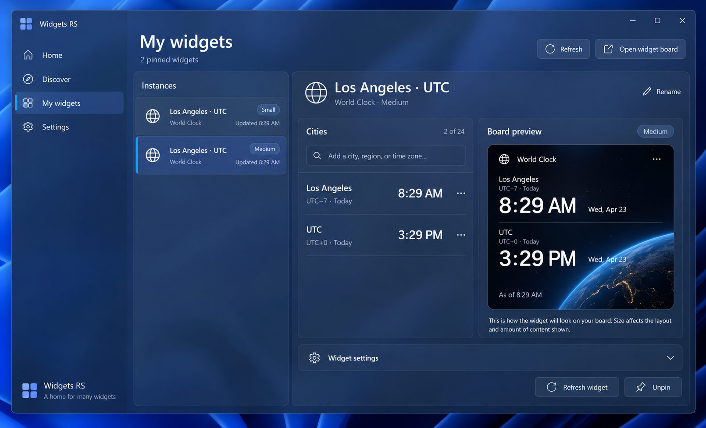
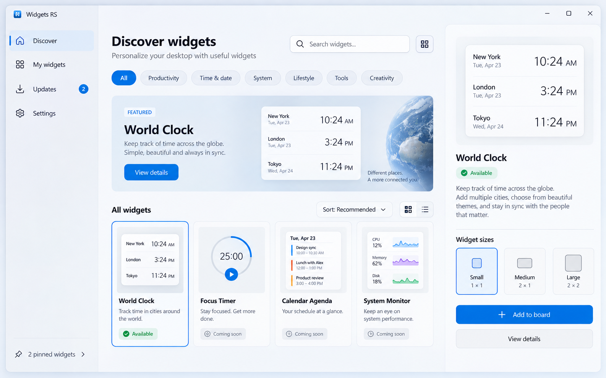
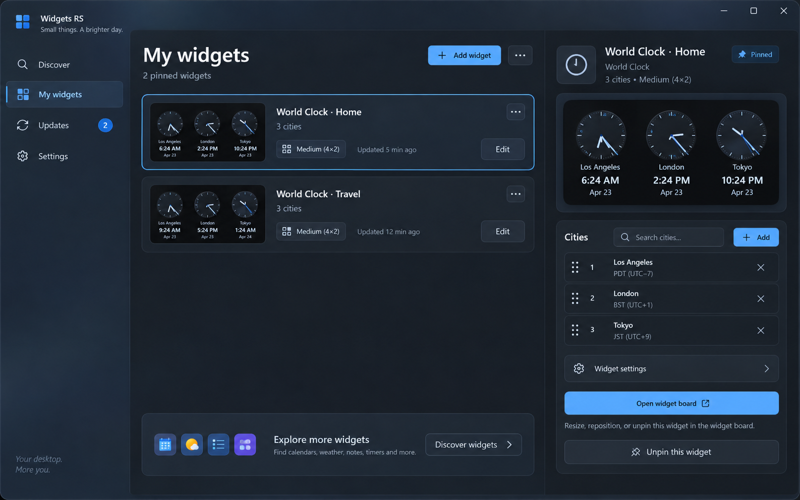
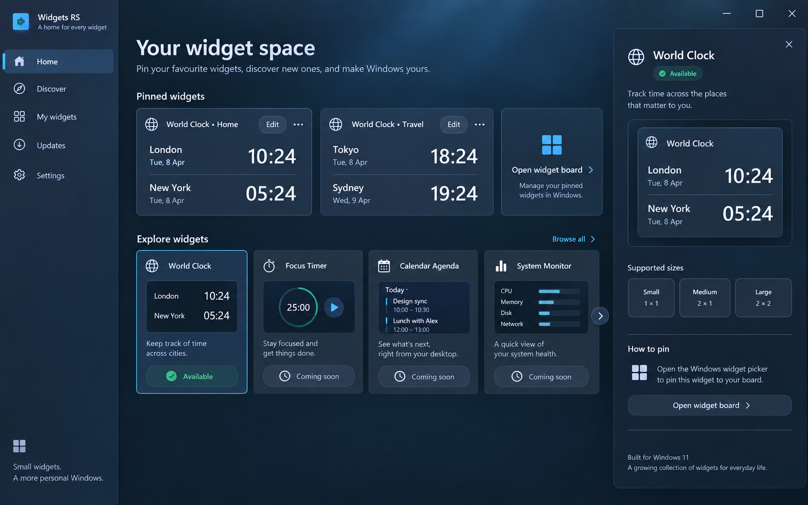

# Widgets RS: app-level UX concepts

The current window edits World Clock instances. The product needs an app shell for discovering widget types and managing every pinned instance as the catalog grows. These are image-generated explorations, not final control specifications.

The current design iteration and its live captures are recorded in [the 30 September visual review](design-review-2026-09-30.md). The [Home target](concepts/home-v2.png), [size-corrected widget target](concepts/widget-family-tall-v3.png), and [digital manager target](concepts/manage-digital-v2.png) supersede the early clock compositions below.

## Current manager target

The instance list identifies pins without repeating a full clock preview. The editor has readable city rows, a separate board preview, explicit Rename, and a fixed footer for Refresh and Unpin. Label, order, and removal controls appear only when a city is selected. The native title bar extends the app surface and keeps Windows caption buttons and drag behavior. Mica's appearance follows the user's wallpaper and active-window state; the generated image exaggerates its blue tint.

The native implementation now uses a compact rail and a list-to-detail flow at narrow widths. City editing replaces the city list with a focused form; Unpin opens a native confirmation with Cancel as its default. The app's rail continues behind its native title bar, with platform branding in the title bar's content area. Translucent theme brushes provide the normal surface hierarchy, while High Contrast removes decorative artwork and uses system colors with an explicit selected-instance cue. City search uses a native suggestion popup and an explicit Add action for the chosen city, so browsing results does not save a zone. Active material and real popup input still need foreground verification. The latest wide and minimum-size captures are listed in the visual review.

## 1. Discover: catalog first

A searchable catalog makes the product's scope clear immediately. A selected widget has a preview, supported sizes, description, and a route to the Windows widget board. This layout scales as definitions are added in package updates. The pictured **Add to board** button is concept art; the shipped action should read **Open widget board** because Windows owns pinning.

## 2. My widgets: instance management

This view treats each pin as its own object. Selecting an instance opens a detail pane with its configuration and preview. The instance list can show widget type, user label, current size, and last update. Its Unpin action should identify the instance and ask for confirmation. The analog faces in the image are visual exploration; World Clock's actual widget remains a compact digital Adaptive Card.

## 3. Home: overview plus discovery

A compact launch page combines the user's pinned instances with a short catalog shelf. It gives repeat visitors a direct path to editing while still making new widget types discoverable. This is the strongest starting screen once more than one widget type is available.

## Recommended structure

| Area | Purpose | First implementation |
| --- | --- | --- |
| Home | Pinned overview and a small discovery shelf | Show current instances and World Clock; use a useful empty state when none are pinned |
| Discover | Search and browse widget types | Show only released definitions; add future types through app updates |
| My widgets | Manage pinned instances across types | List instances, select one, edit its settings, preview its size, and request removal with confirmation |
| Settings | App-wide preferences and about information | Keep separate from per-instance widget configuration |

Use a native left navigation shell, a responsive catalog grid, and a master/detail instance view. World Clock's city editor belongs in the selected instance's detail surface. The right pane can collapse to a full page at smaller window widths. Use semantic WinUI theme brushes and test Light, Dark, and High Contrast; every action needs keyboard access and an automation name.

The mockups show Focus Timer, Calendar Agenda, and System Monitor to test the catalog layout. They are **not implemented or promised**. The first real catalog entry is World Clock.

## Platform-grounded actions

- **Pin:** open the Windows widget board and guide the user to its picker. `WidgetManager` works with existing widgets; it does not create a pinned widget. [WidgetManager reference](https://learn.microsoft.com/en-us/windows/windows-app-sdk/api/winrt/microsoft.windows.widgets.providers.widgetmanager?view=windows-app-sdk-2.0), [widget picker guidance](https://learn.microsoft.com/en-us/windows/apps/design/widgets/widgets-picker-integration)
- **List and edit:** read the app's instances from `GetWidgetInfos`, including size and custom state, then update the selected instance with `UpdateWidget`. [GetWidgetInfos reference](https://learn.microsoft.com/en-us/windows/windows-app-sdk/api/winrt/microsoft.windows.widgets.providers.widgetmanager.getwidgetinfos?view=windows-app-sdk-2.0)
- **Unpin:** `DeleteWidget` can request removal of an existing widget. Confirm the particular instance in the app first. [WidgetManager reference](https://learn.microsoft.com/en-us/windows/windows-app-sdk/api/winrt/microsoft.windows.widgets.providers.widgetmanager?view=windows-app-sdk-2.0)
- **Future catalog entries:** each shipped type needs its own provider definition in the package manifest, so catalog availability must track what the installed package actually registers. [Provider manifest](https://learn.microsoft.com/en-us/windows/apps/develop/widgets/widget-provider-manifest)

The full generation prompts are saved in [concepts/prompts.md](concepts/prompts.md). The images are UX references and are not bundled into the MSIX.
